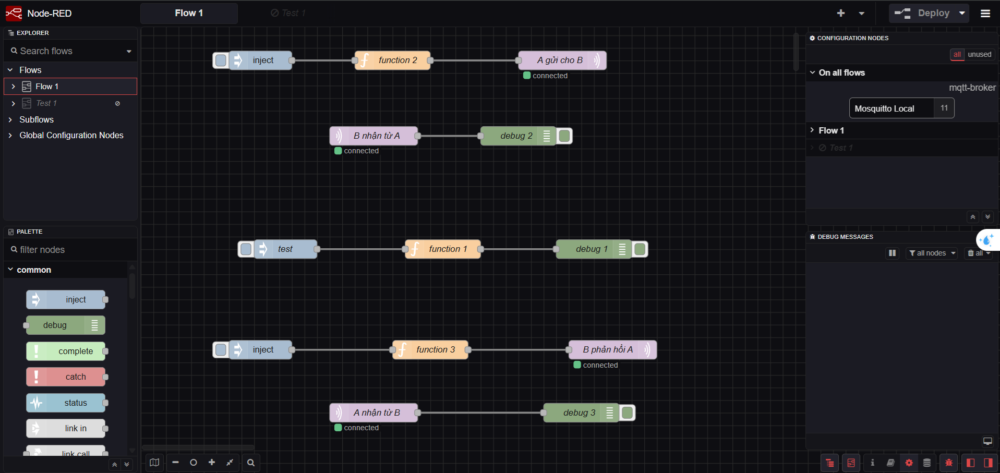
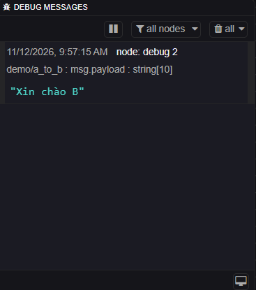
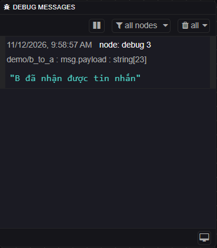

# MQTT Communication Using Node-RED and Mosquitto

## 1. Project Overview

This project demonstrates a basic two-way communication system using the **MQTT (Message Queuing Telemetry Transport)** protocol.

The system is developed with **Node-RED** and uses **Eclipse Mosquitto** as the MQTT broker.

Two communication endpoints, A and B, exchange messages through the MQTT Publish/Subscribe mechanism.

The main objectives are:
- Understand the basic concepts of MQTT communication.
- Configure and connect Node-RED to an MQTT broker.
- Send and receive messages using MQTT topics.
- Implement two-way communication between A and B.
- Observe and verify message exchange using Node-RED Debug nodes.

## 2. Technologies Used

| Technology | Purpose |
|---|---|
| Node.js | Runtime environment required by Node-RED |
| Node-RED | Visual programming tool for creating the MQTT communication flows |
| Eclipse Mosquitto | MQTT broker that receives and distributes messages |
| MQTT | Publish/Subscribe messaging protocol |
| Git & GitHub | Version control and project hosting |

## 3. System Architecture

The project consists of three main components:

- **MQTT Broker:** Mosquitto runs locally on `localhost:1883` and manages message distribution.
- **Endpoint A:** Publishes messages to B and subscribes to messages from B.
- **Endpoint B:** Subscribes to messages from A and publishes messages back to A.

### Communication Diagram



### MQTT Topics

The system uses two topics for bidirectional communication:

| Sender | Receiver | MQTT Topic | Message |
|---|---|---|---|
| A | B | `demo/a_to_b` | Xin chào B |
| B | A | `demo/b_to_a` | B đã nhận được tin nhắn |

The broker distributes each published message to clients that subscribe to the corresponding topic.

## 4. Installation and Setup

### 4.1. Install Node.js

Download and install Node.js from:

https://nodejs.org/

Verify the installation:

```bash
node -v
npm -v
```

### 4.2. Install Node-RED

Open Command Prompt and run:

```bash
npm install -g node-red
```

Start Node-RED:

```bash
node-red
```

Open the Node-RED editor in a web browser:

http://localhost:1880

### 4.3. Install Eclipse Mosquitto

Download and install Eclipse Mosquitto:

https://mosquitto.org/download/

Open a separate Command Prompt and start the Mosquitto broker:

```cmd
cd /d "C:\Program Files\mosquitto"
mosquitto -v
```

The broker runs locally on port `1883`.

Keep the broker terminal open while testing the project.

## 5. Import the Node-RED Flow

1. Start the Mosquitto broker.
2. Start Node-RED.
3. Open `http://localhost:1880`.
4. Click the menu icon in the top-right corner.
5. Select **Import**.
6. Choose the `flow.json` file from this repository.
7. Click **Import** to load the flow.
8. Click **Deploy** to activate the nodes.

Make sure the MQTT nodes are configured to connect to:

- Server: `localhost`
- Port: `1883`

## 6. Implementation

The project implements two-way communication using MQTT Publish and Subscribe nodes.

### 6.1. Communication from A to B

**Publishing side (A):**

The Inject node triggers a Function node. The Function node sets the MQTT topic and message payload.

```javascript
msg.topic = "demo/a_to_b";
msg.payload = "Xin chào B";
return msg;
```

The MQTT Out node publishes the message to the broker.

**Receiving side (B):**

The MQTT In node subscribes to:

```text
demo/a_to_b
```

When A publishes a message, B receives it through the MQTT broker. A Debug node displays the received payload.

### 6.2. Communication from B to A

**Publishing side (B):**

The Function node prepares the message:

```javascript
msg.topic = "demo/b_to_a";
msg.payload = "B đã nhận được tin nhắn";
return msg;
```

The MQTT Out node publishes the message to the broker.

**Receiving side (A):**

The MQTT In node subscribes to:

```text
demo/b_to_a
```

A Debug node displays the message received from B.

## 7. Testing and Results

### 7.1. Test A → B

1. Make sure the MQTT broker is running.
2. Deploy the Node-RED flow.
3. Check that the MQTT nodes are connected.
4. Click the Inject button on A's publishing flow.
5. Open the Debug panel and verify that B receives:

```text
Xin chào B
```

**Result:**



### 7.2. Test B → A

1. Click the Inject button on B's publishing flow.
2. Open the Debug panel and verify that A receives:

```text
B đã nhận được tin nhắn
```

**Result:**



### 7.3. Expected Results

| Test | Expected Result | Status |
|---|---|---|
| A publishes to `demo/a_to_b` | B receives the message | Passed |
| B publishes to `demo/b_to_a` | A receives the message | Passed |

## 8. Project Structure

```text
MQTT-Communication/
│
├── flow.json
├── README.md
│
└── screenshots/
    ├── mqtt-flow.png
    ├── a-to-b.png
    └── b-to-a.png
```

- `flow.json`: Exported Node-RED flow containing the MQTT communication configuration.
- `README.md`: Project documentation and instructions.
- `screenshots/`: Screenshots showing the communication flow and test results.

## 9. Conclusion

This project demonstrates a basic MQTT Publish/Subscribe communication model using Node-RED and Eclipse Mosquitto.

Through this implementation, the two endpoints can exchange messages in both directions using different MQTT topics.

The project provides practical experience with MQTT brokers, topics, publishers, subscribers, and message exchange.

## 10. Scope and Limitations

This is a basic educational MQTT communication project.

- The MQTT broker runs locally on the same computer.
- Communication is demonstrated between two logical endpoints in Node-RED.
- Messages are predefined for testing purposes.
- The project does not include physical sensors, a database, or a separate user interface.